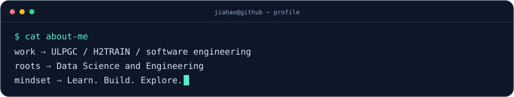

  

  <b>Software engineering &nbsp;·&nbsp; Data engineering &nbsp;·&nbsp; Data science &nbsp;·&nbsp; AI</b>

  

## 👋 A little about me

I'm **Jiahao**, a **Data Science and Engineering graduate** from the **University of Las Palmas de Gran Canaria (ULPGC)**.

I currently work at **ULPGC** on the **H2TRAIN** project, contributing across different technical areas with a primary focus on **software engineering**.

  

## 🛠️ My toolkit

  

  <b>Python &nbsp; · &nbsp; Docker &nbsp; · &nbsp; Linux &nbsp; · &nbsp; Bash scripting</b>

## 🧭 What drives me

| 💻 Software & systems | 📊 Data & intelligence |
| :--- | :--- |
| Building software, solving practical problems, and understanding how systems work. | Exploring data engineering, data science, and artificial intelligence. |

## ⚡ Beyond the code

I'm passionate about **technology and the wider tech industry**. I enjoy discovering new tools, learning how things work, and connecting ideas across software and data.

---

  <b>Curious about technology. Always learning.</b>  
  <a href="https://www.linkedin.com/in/jia-hao-yang-2932b61ba/">Let's connect on LinkedIn ↗</a>

